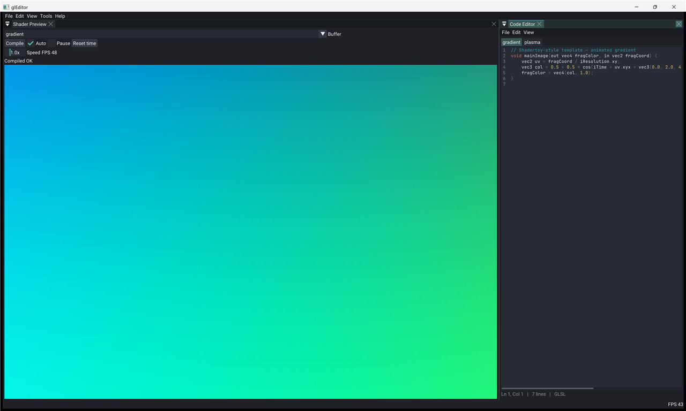

# glEditor



RigKit port of the [gleditor](https://github.com/1ay1/gleditor) workflow - edit GLSL, live preview, compile errors, Shadertoy uniforms - on **Rig + UI** (ImGui), not GTK.

## Start playing (read this first)

You write a tiny program called a **shader**. It runs once for every dot (pixel) on the screen and decides that dot's colour. Change the code, and the picture changes as you type.

1. Run glEditor (build steps below).
2. Left window is the picture (**Shader Preview**). Right window is the code (**Code Editor**). Pick an example in the preview's **Buffer** list or click a tab in the Code Editor - the two always show the same shader.
3. Start at **01 First Colour** and work up in number order. Each example teaches one new idea, and each file starts with a **TRY THIS** list: small changes to make, guessing what will happen before you look.
4. Made a typo? Red error text appears and the last good picture stays on screen. The error names the line, counted in the file you are editing - fix that line and the picture comes back. Nothing you type can break the app.
5. **99 Make Your Own** is a scratch pad with a starter picture and a recipe book pointing back at the examples. In the Code Editor, File > Save As... keeps your invention as a `.glsl` file you can keep.

One seam to know: files opened with File > Open... do not drive the preview. Paste the code into the **99 Make Your Own** tab to see it live - the preview reads the seeded buffers, not loose editor files.

Rules of the game that help:

- Change **one number at a time**, guess first, then look. That guessing is where the learning happens.
- Numbers in colours run 0.0 to 1.0. Write decimals with a dot: `2.0`, never just `2`, inside colour and position maths.
- Every code line ends with `;`. Most red errors are a missing `;` or a missing `)`.
- The **Speed** slider and **Pause** in the preview tame fast animations. **Reset time** restarts the clock.

### The example path

| Tabs | What you learn |
|------|----------------|
| 01-03 | Colours are three numbers; mixing; the moving rainbow wave |
| 04-05 | Stripes from counting; a circle from distance |
| 06-07 | Animation with the clock; the mouse as a paintbrush |
| 08-11 | Grids: checkerboards, rings, polka dots - naming cells with `floor` / `fract` |
| 10 | Plasma: sine waves added together |
| 12 | A sunset scene: stacking the earlier tricks in layers |
| 13 | Bending coordinates to warp any picture |
| 14-15 | Stars and clouds: "random" numbers that hold still (`hash`, noise) |
| 16-17 | Tunnel and kaleidoscope: polar coordinates and folding space |
| 18 | Julia fractal (boss level): one sum, repeated 48 times per pixel |
| 99 | Your scratch pad - steal one ingredient at a time |

### Words you will meet

| Word | Means |
|------|-------|
| pixel | One dot of the picture. The shader runs once per pixel. |
| `fragCoord` | "Which pixel am I?" - x across, y up, in pixels. |
| `uv` | Position squashed to 0.0 to 1.0 across and up the screen. |
| `p` | Recentred position: (0, 0) in the middle, y up. Shapes like this one. |
| `vec2` / `vec3` / `vec4` | Two / three / four numbers bundled together. A colour is a `vec3` (red, green, blue); the final answer is a `vec4` (plus alpha: how solid). |
| `iTime` | A clock in seconds, ticking since the picture started. |
| `iResolution` | The picture size in pixels (`vec3`; `.xy` is width, height). |
| `iMouse` | Mouse over the preview: `.xy` where it is (pixels), `.z` above 0 while the button is held down. |

### Challenges (after the TRY THIS lists)

- **Weather report**: turn 12 Sunset into a storm - grey sky, dark fast sea, no sun. Then into an alien sunset with two suns.
- **Flag day**: use 04 Stripes plus 13 Wavy Picture to make a waving flag in your favourite colours.
- **Disco floor**: 08 Checkerboard, but each square gets 03's rainbow and the colours chase across the floor with `iTime`.
- **My planet**: put 15 Clouds over 12 Sunset's sea. One ingredient at a time.
- **Fractal explorer**: in 18, hold the mouse and drag very slowly. Find a snowflake. Now change the zoom to 0.8 and explore inside it.

### For grown-ups helping

No setup beyond running the app, and no way to damage anything: edits live in memory, a failed compile keeps the last good picture, and restarting restores the examples (Save As... writes a `.glsl` file to keep one). One example at a sitting beats five skimmed. The maths hiding inside - fractions, coordinates, sine waves, Pythagoras in example 05 - is school maths doing visible work; name it when it shows up ("that *is* the distance formula") but do not front-load it. Let the TRY THIS guessing run first.

Pi note: this is desktop authoring chrome (code editor font). The preview compiles the same shaders as GLES `#version 100` when `RIGKIT_GLES` is set, so the examples stick to that subset: decimals everywhere, fixed loop counts, no textures.

## First-run chrome

On first boot (no saved `data/user/workspaces/imgui.ini` split):

| Region | Window |
|--------|--------|
| Center | **Shader Preview** - Compile / Auto / Pause / FPS / errors + FBO image |
| Right | **Code Editor** (`rigCodeEditor`) - GLSL highlight over `CCode` buffers |

Layout is saved under `data/user/workspaces/imgui.ini`. Reset by deleting that file (or the example `build/` tree and reconfiguring).

Seeded buffers: every numbered file in `data/` (`language = "glsl"`), in learning order, with `99 Make Your Own` last as the scratch pad. The Code Editor tab and the Shader Preview **Buffer** selection stay in sync - whichever you change, the other follows. `--smoke` compiles every seeded example and verifies that a deliberately broken shader keeps the last-good program, so a broken example fails the smoke instead of surprising a first-time user.

## Shadertoy uniforms

```glsl
uniform vec3 iResolution;
uniform float iTime;
uniform vec4 iMouse; // xy current, zw click
void mainImage(out vec4 fragColor, in vec2 fragCoord);
```

Host wraps `mainImage` for GLES (`#version 100`) or desktop (`#version 330`) and inserts `#line 1` ahead of the user source, so compiler error line numbers match the editor. Only this subset is provided: no textures, no multipass, no `iFrame` / `iDate` / audio uniforms.

## Live reload (TODO.md beachhead)

Repo TODO: *runtime hot-reload (DLL / shader)*. This example probes the **shader** half only:

| Layer | Behavior here |
|-------|----------------|
| **Shader source** | Edit `CCode` then auto-compile (debounce), then swap GPU program; **keep last-good** on failure |
| **Disk watch** | If `CAssetRef` is on the same entity, poll mtime, then reload text, bump `epoch` (external editor) |
| **Pack DLL** | **Not implemented** - `MPack::reloadPack` still re-inits STATIC only; no `dlopen` |

Structure stays open for a future pack SHARED path; this app does not add one.

The disk watch reads the deployed copies under the build tree's `bin/data/`, not the source `data/` in this folder - editing source files while the app runs does not reload; rebuild (or edit in the app) instead.

## Build

```bash
cmake -S examples/glEditor -B examples/glEditor/build
cmake --build examples/glEditor/build --target glEditor
./examples/glEditor/build/bin/glEditor
./examples/glEditor/build/bin/glEditor --smoke
```

## Packs

- **rigComponent** - `CCode`
- **rigSystems** - present spine
- **rigImGui** - dock host
- **rigCodeEditor** - TextEditorPanel + JetBrains Mono (author-tool weight; opt-in)

## Still deferred

Multipass BufferA-D, adaptive resolution, NeoWall install, theme library, GLSL autocomplete, session tab restore, promoting preview into a pack, pack DLL hot-reload, previewing disk-opened editor files without pasting into a seeded buffer.
