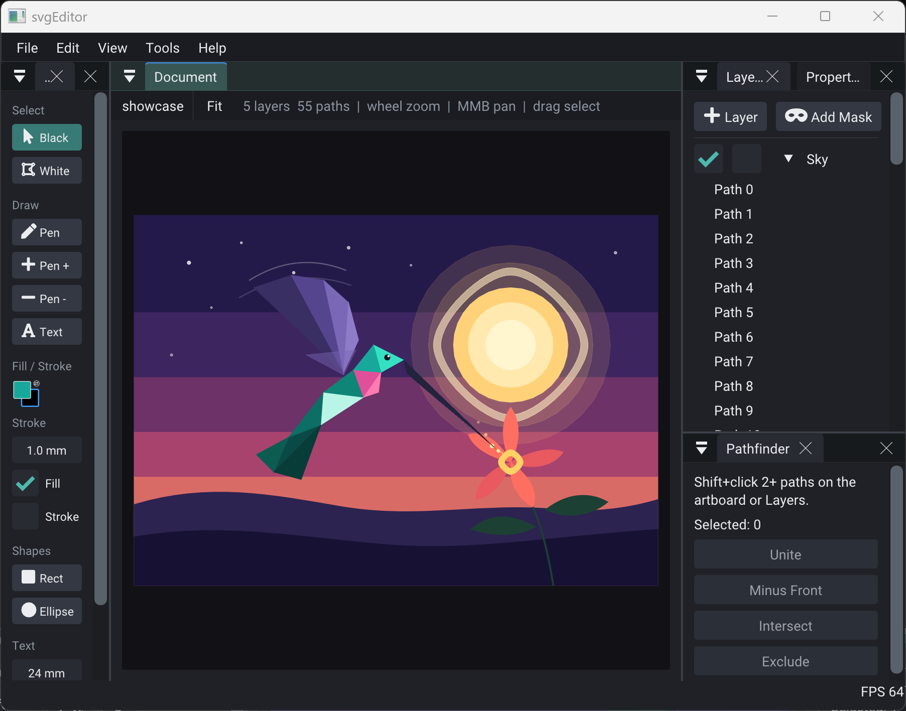

# svgEditor



Dedicated **artboard Kit** example - not the plotter CNC kit. SVG stays Import / Export via **rigSvg**.

## First-run chrome

| Region | Window |
|--------|--------|
| Left | **Toolbar** - Select / Pen / Rect / Ellipse / Spiral / Text outlines |
| Center | **Artboard** - warm paper on dark desk, filled + stroked paths |
| Right top | **Layers** \| **Properties** (tabs) |
| Right bottom | **Pathfinder** \| **Align** (tabs) |

Demo: Letter (filled compound `a`) + Blob (stroked circle), letter preselected.

## Build

```bash
cmake -S examples/svgEditor -B examples/svgEditor/build
cmake --build examples/svgEditor/build --target svgEditor
./examples/svgEditor/build/bin/svgEditor/svgEditor
./examples/svgEditor/build/bin/svgEditor/svgEditor --smoke
```

## Packs

- **rigVectorUi** - artboard Kit (this example's product surface)
- **rigVectorEditor** - path edit / text / Pathfinder / soft mask
- **rigColorspace** - color POD + conversion, grey value / contrast, harmonies (Swatches UI later)
- **rigCompositor** - FBO bake/blit + path masks (Layers Add Mask to artboard composite)
- **rigPlotter** + **rigSvg** - document + SVG I/O
- **rigDxf** - DXF open / import / export (GPL-2.0-or-later, dxflib). This example binary is GPL when built with it; the app may move out of tree later
- **rigImGui** - dock host

CNC plotter panels (`rigPlotterUi` Finders/Generators/GRBL/...) are **not** registered.

## Drop files

Drop a file on the **Document** window (not Layers / Properties).

| Session | Result |
|---------|--------|
| Empty | Opens the first file; extra files in the same drop are imported |
| Document open | **Dropped file** asks Replace, Import, or Cancel |

Supported: `.svg`, `.rig`, images (png/jpg/bmp/gif/tga), and `.dxf`. Import adds layers (or places an image) and is one undo.

DXF import (File > Import DXF, Open, or drop) honors **Preferences > Import**: join exploded LINE entities, shift the drawing origin onto the page, flip Y for the Y-down artboard, promote faceted circles / arcs, and optionally import text and dimensions (dimensions can land on their own layer).

Coverage is the **rigDxf 2D subset**, not the Autodesk spec. Paths, fills, text, images, leaders, and construction lines that the artboard can already present are imported and written back. See [packs/rigDxf/docs/dxf-coverage.md](../../packs/rigDxf/docs/dxf-coverage.md). Skipped counts that the parser sees are logged as `[PlotDoc] DXF`. File > Export DXF writes the same kinds.

GLFW drop works on desktop / Pi X11 or Wayland. It does nothing under KMS/DRM kiosk.

## Still deferred

Full Modify tools, Swatches/CMYK UI, Tab edit mode, Pages bar, Object menu Arrange, pencil,
polygon, gradient editor modal.
