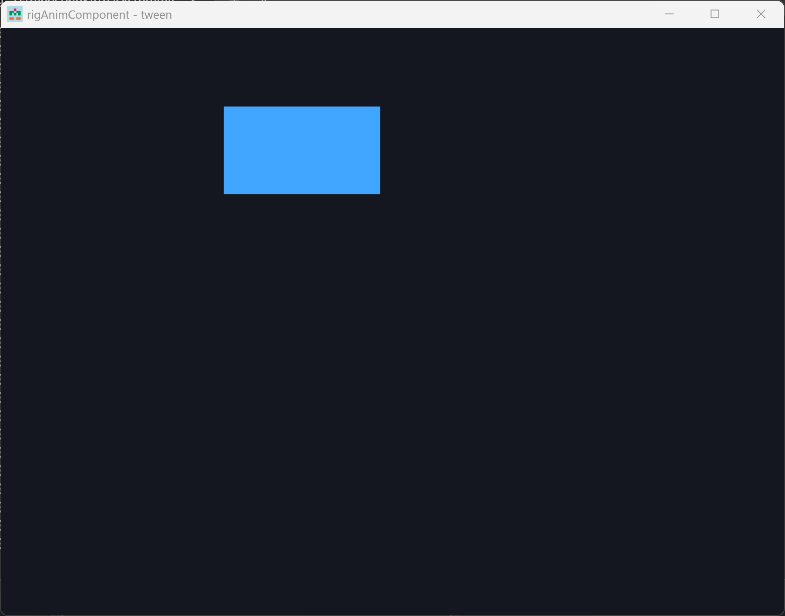

# rigAnimComponent

Tween, LFO, and binding PODs. 

> Data only

Advance is **rigSystems** (`STweens` / `SModulators`).
`CCurve` in **rigComponent**.

[API/docs](https://rigkid.github.io/rigAnimComponent/)
